<h1 align="center">ANN Vector Search Library</h1>

<p align="center">
  <em>An approximate nearest neighbor vector search library built from scratch in pure Python, implementing HNSW (Hierarchical Navigable Small World) graphs. High recall at a fraction of a brute-force scan's distance computations.</em>
</p>

<p align="center">
  <a href="https://github.com/adeoluo/ann-vector-search-library/actions/workflows/ci.yml"></a>
  
  
  
  
  
</p>

---

## Motivation

Nearest-neighbor search is the core of retrieval, recommendation, and
retrieval-augmented generation. A brute-force scan compares the query to every stored vector,
which is exact but costs one distance computation per point. **HNSW** builds a layered proximity
graph that reaches the true neighborhood while touching only a small fraction of the points. This
library implements HNSW from scratch following Malkov and Yashunin (2016), with **zero runtime
dependencies** and no numerical libraries.

The headline is the trade-off itself: the library reports recall against exact search **and** the
number of distance computations it performs, so the saving is measured, not asserted.

## Architecture

<p align="center">
  
</p>

Insertion assigns each point a random maximum level from a geometric distribution, greedily
descends through the sparse upper layers, then runs a bounded best-first search at each lower
layer and connects to neighbors chosen by a distance heuristic that spreads edges around the
point. Search mirrors insertion. See the [ADRs](docs/adr/) for the key decisions.

## What it implements

- **Layered graph construction** with geometric level assignment and bidirectional edges.
- **The neighbor-selection heuristic** that keeps connections diverse rather than clustered.
- **Bounded best-first search** (the ``ef`` beam) at the bottom layer, with greedy descent above.
- **Degree pruning** to a maximum of ``M`` edges per node (``2M`` at the base layer).
- **A brute-force index** and a **distance counter** so recall and cost are both measured.

## Results

> Reproduce with `python -m ann_vector_search_library benchmark`. Dataset: 2000 clustered
> 16-dimensional vectors; 100 held-out queries; recall@10 against exact search.

| Search width (ef) | Recall@10 | Distance ops/query | Fewer than brute force |
|---|---:|---:|---:|
| 16 | 0.755 | 146 | **13.7x** |
| 32 | 0.871 | 208 | 9.6x |
| 64 | 0.945 | 280 | 7.1x |
| 128 | 0.969 | 377 | 5.3x |

At ``ef`` 64 the index reaches **0.945 recall@10 while computing 280 distances per query versus
2000 for an exhaustive scan, a 7.1x reduction**. The search width ``ef`` trades recall against
cost along a smooth curve, and the saving grows with dataset size because graph search scales far
better than a linear scan.

### Wall-clock time against an exact scan

Distance-computation counts show the algorithmic saving, but latency is what a caller feels. This
comparison measures real query time against this library's own pure-Python exact scan, averaged
over three seeds (`ef` 64, dim 16, 50 queries per seed):

| Vectors | Build time | Index query | Exact scan | Index speed-up | Recall@10 |
|---|---:|---:|---:|---:|---:|
| 1,000 | 0.42 s | 0.277 ms | 0.849 ms | 3.1x | 0.991 |
| 2,000 | 0.94 s | 0.343 ms | 1.712 ms | 5.0x | 0.943 |
| 4,000 | 2.21 s | 0.425 ms | 3.647 ms | 8.6x | 0.865 |

Against a same-language exact scan the index is faster, and the gap widens with dataset size
because its query cost grows far more slowly than a linear scan. The honest caveat is that this is
a same-interpreter comparison: an **optimized compiled library** (for example a vectorized exact
search in FAISS, hnswlib, or scikit-learn) can still outperform pure-Python approximate search on
small to medium workloads, because fewer distance computations do not offset per-operation
interpreter overhead. Establishing competitive absolute latency would require either a compiled
kernel or a matched-recall comparison against those libraries, which is noted in the roadmap.

## Demonstration

```text
$ python -m ann_vector_search_library benchmark
Built HNSW over 1000 vectors (dim 16, M 8).
Recall and distance-computation cost against exact search:
  ef=16: recall=0.8600, 123 vs 1000 distance ops/query (8.1x fewer)
  ef=32: recall=0.9140, 163 vs 1000 distance ops/query (6.2x fewer)
  ef=64: recall=0.9740, 221 vs 1000 distance ops/query (4.5x fewer)
  ef=128: recall=1.0000, 324 vs 1000 distance ops/query (3.1x fewer)
```

## Quickstart

```bash
git clone https://github.com/adeoluo/ann-vector-search-library.git && cd ann-vector-search-library
make setup                      # install dev tooling + pre-commit hooks
make all                        # lint + type-check + test

python -m ann_vector_search_library benchmark   # recall and cost against exact search
python -m ann_vector_search_library search       # approximate vs exact neighbors for one query
python -m ann_vector_search_library serve        # start the HTTP service on :8000
```

```python
from ann_vector_search_library import HNSW

index = HNSW(dim=3, m=8, seed=0)
index.add(0, [0.1, 0.2, 0.3])
index.add(1, [0.9, 0.8, 0.7])
print(index.search([0.15, 0.2, 0.25], k=1))  # [(0, ...)]
```

## HTTP service

A standard-library HTTP service builds the index at startup, then answers queries. The routing
logic is a pure function, tested without a socket. Under a concurrent stress benchmark
(`uv run python benchmarks/stress.py`, 3000 requests, 8 workers) the `/search` handler sustains
roughly **600 queries/second** at **p50 1.4 ms** on one CPU.

| Method | Path | Purpose |
|---|---|---|
| GET | `/health` | liveness and index size |
| GET | `/ready` | readiness once the index is built |
| GET | `/metrics` | per-route request, error, and latency metrics (Prometheus text) |
| POST | `/search` | body `{"vector": [float], "k": int?, "ef": int?}`; nearest neighbors |
| GET | `/recall` | recall@k of the index against exact search on held-out queries |

## Design decisions

- **HNSW over IVF or a k-d tree** - HNSW gives strong recall in high dimensions where tree
  methods degrade, and it supports incremental insertion. See [ADR 0002](docs/adr/0002-hnsw.md).
- **A measured distance counter** - reporting comparisons per query makes the recall/cost
  trade-off concrete rather than a claim. See [ADR 0003](docs/adr/0003-measured-cost.md).

## Evaluation

Datasets and queries are generated deterministically, so every number reproduces offline. Full
method and tables: [`docs/EVALUATION_REPORT.md`](docs/EVALUATION_REPORT.md).

## Responsible AI

- **Model card:** [`docs/MODEL_CARD.md`](docs/MODEL_CARD.md)
- **Data card:** [`docs/DATA_CARD.md`](docs/DATA_CARD.md)
- **Threat model:** [`docs/THREAT_MODEL.md`](docs/THREAT_MODEL.md)

## Comparison scope

The reported reductions are relative to an exhaustive brute-force scan, measured as distance
computations per query, not wall-clock time and not relative to an optimized library. This
project has **not** been benchmarked against [FAISS](https://github.com/facebookresearch/faiss)
or [hnswlib](https://github.com/nmslib/hnswlib), and it does not claim to beat them: a pure-Python
implementation will not match a compiled library's wall-clock latency, and fewer distance
computations do not by themselves imply faster execution. What the result establishes is the
recall-versus-comparison-count trade-off of the HNSW algorithm itself. A controlled comparison
against hnswlib on a shared dataset, including wall-clock latency, is the natural next step.

## Limitations

- Pure-Python distance math is slow per comparison; the win is in doing far fewer of them, not in
  the speed of each. An optimized kernel would lower absolute latency.
- The index is in-memory and not persisted; there is no on-disk format or deletion support.
- Recall depends on ``M`` and ``ef``; the defaults suit the bundled datasets and may need tuning
  for other distributions.

## Roadmap

- [ ] Benchmark recall and wall-clock latency against hnswlib and FAISS on a shared dataset.
- [ ] Add node deletion with lazy tombstones and re-linking.
- [ ] Add a persisted on-disk index format.
- [ ] Add scalar quantization of stored vectors to cut memory.

## License

[MIT](LICENSE)
