<h1 align="center">ANN Vector Search Library</h1>

<p align="center">
  <em>An approximate nearest neighbor (ANN) search library, built from scratch in Python with a Rust core, that uses Hierarchical Navigable Small World (HNSW) graphs and measures its accuracy and cost against exact search.</em>
</p>

<p align="center">
  <a href="https://github.com/adeoluo/ann-vector-search-library/actions/workflows/ci.yml"></a>
  <a href="https://github.com/adeoluo/ann-vector-search-library/releases"></a>
  
  
  <a href="LICENSE"></a>
</p>

---

> **Evidence level: publicly benchmarked.** Recall is measured on SIFT, a public set of image descriptors, against hnswlib and FAISS. Tests check the Rust core against the Python reference version. No one else has reproduced the results, and the library is not used in production. [What the levels mean](https://github.com/adeoluo#evidence-levels).

## Highlights

Search over AI embeddings (lists of numbers that represent text or images) means finding the
stored items closest to a query. Checking every item gives the exact answer, but it is slow.
This library builds a layered graph with the HNSW method, so a search visits only a small part
of the data. It is written from scratch so that every step can be read.

- **It does 7.1 times less work and still finds most of the true nearest items.** On a set of
  2,000 generated vectors, it finds 94.5% of the true 10 nearest items. It computes 280
  distances per query, compared with 2,000 for checking every vector.
- **It is as accurate as hnswlib, the standard C++ HNSW library.** Both reach a recall of 0.926
  on the same 10,000 vectors with the same settings. Recall is the share of the true nearest
  items found, from 0 to 1, and higher is better.
- **A Rust core gives the speed, and tests check it against the readable Python version.** In
  its exact `f64` mode, the Rust core builds an index 38 to 40 times faster than the Python
  index. It answers a query 21 to 23 times faster and returns the same answers.

**Where it falls short:** the pure Python version answers a query about 27 times slower than
hnswlib. It is the version meant for reading, not for serving. The Rust core has been timed on
one Apple M1 (ARM) machine only.

## Key terms

Plain definitions of the terms used in this README.

| Term | Meaning |
|---|---|
| Approximate nearest neighbor (ANN) search | Finding the stored vectors closest to a query without checking every one. It is much faster than exact search but can miss some true neighbors. |
| Brute-force search (exact scan) | Comparing the query with every stored vector. It always finds the true nearest neighbors, so it gives the correct answers (the ground truth). |
| Build time | Time to insert all vectors and build the index, in seconds. Lower is better. |
| Cosine distance | One minus the cosine of the angle between two vectors. It is 0 when they point the same way. One of the two distance measures this library supports. |
| Distance computations per query | How many vector-to-vector distances one search calculates ("distance ops/query"). It measures the work done. Lower is better. |
| `ef` (search width) | How many candidates a search keeps in its list at the bottom layer. Larger `ef` gives higher recall but costs more work. |
| `ef_construction` | The search width used while building the graph. Larger values search more widely during building, which takes longer. |
| Embedding | A list of numbers (a vector) that represents text, an image, or another item, so that similar items get nearby vectors. |
| Euclidean distance | The straight-line distance between two vectors. This library ranks by its square, which gives the same order and skips a square root. |
| `f32` and `f64` | Numbers stored with 32 or 64 bits. The Rust core's `f64` mode copies the Python results exactly. Its `f32` mode is faster. |
| FAISS | Meta's similarity-search library, written in C++. Its "flat" index is an exact scan of every vector. |
| HNSW | Hierarchical Navigable Small World: a graph in several layers. Sparse upper layers allow long jumps, and the dense bottom layer finds the close neighbors. |
| hnswlib | The widely used C++ implementation of HNSW, with Python bindings. This project uses it as the reference for recall and speed. |
| `k` | How many nearest neighbors a search returns. Most results here use `k` 10. |
| `M` | The maximum number of links per node in each graph layer (twice that at the bottom layer). Larger values use more memory. |
| p50 latency | The median time to answer a request: half of all requests finish faster. Lower is better. |
| Parity test | A test that runs two implementations on the same input and requires matching results, for example the Rust core against the Python index. |
| Peak memory | The most memory Python allocated during a benchmark run, in mebibytes (MiB). Lower is better. |
| Query latency | Time to answer one query, in milliseconds (ms). Lower is better. |
| Recall@k (recall@10) | The share of the true `k` nearest neighbors that the search returns, from 0 to 1. Higher is better. 0.945 means 94.5% were found. |
| Rust core | The compiled Rust version of the same HNSW algorithm, built into the Python package and used by default. |
| SIFT (SIFT1M) | A public benchmark of one million image descriptors, each 128 numbers that describe a small image patch, with a set of query vectors. |
| SIMD | Single instruction, multiple data: processor instructions that do the same operation on several numbers at once. They speed up distance math. |
| Speed-up ("x fewer", "x faster") | How many times less work or time the index needs compared with a baseline. For example, 7.1x means 7.1 times fewer. Higher is better. |
| Throughput | Queries answered per second (q/s). Higher is better. |

## Motivation

Nearest-neighbor search finds the stored vectors closest to a query vector. It is the core step
of search, recommendation, and retrieval-augmented generation (RAG). In RAG, a language model
first looks up relevant documents and then writes its answer from them. A brute-force scan compares
the query with every stored vector. It is exact, but it needs one distance computation per
stored vector. **HNSW** builds a graph in layers that links each point to nearby points. A search
follows these links to the true neighborhood and touches only a small share of the points. This
library implements HNSW from scratch, following the HNSW paper by Malkov and Yashunin (2016). The graph
construction, the search, and the distance computations are all written out in the package.

The main result is this trade-off itself. The library reports recall against exact search
**and** the number of distance computations it performs, so the saving is measured, not only
claimed.

## Architecture

<p align="center">
  
</p>

<sub>Legend: amber = entry points and external systems, indigo = core logic, green = data and state, blue = validation and control, grey = observability and outputs.</sub>

Insertion has four steps. First, each new point gets a random top layer. Higher layers are less
and less likely (a geometric distribution). Second, the insertion moves greedily down through
the sparse upper layers, always stepping to the closest neighbor. Third, at each lower layer it
runs a bounded best-first search, which keeps a fixed-size list of the best candidates found so
far. Fourth, it links the point to neighbors chosen by a distance rule that spreads the links
around the point.

Search follows the same path. The query's dimension is checked first. The search then moves
greedily down the upper layers, widens to a list of `ef` candidates at the bottom layer, and
returns the `k` closest. A brute-force index over the same vectors gives the exact answers. So
recall, distance counts, and the comparison with other libraries are all measured. The HTTP
service records Prometheus metrics for each route (request counts, errors, and latency, in the
text format that the Prometheus monitoring system reads). The [ADRs](docs/adr/) (architecture
decision records) explain the key decisions.

### What it implements

- **Layered graph construction.** Each point gets a random top layer from a geometric
  distribution, and links go in both directions.
- **The neighbor-selection heuristic.** A candidate is kept only if it is closer to the new point
  than to any neighbor already chosen. This spreads the links out instead of clustering them in
  one direction.
- **Bounded best-first search** at the bottom layer, with a candidate list of size ``ef`` (the
  ``ef`` beam), and greedy descent in the layers above.
- **Degree pruning.** Each node keeps at most ``M`` links per layer, and ``2M`` at the bottom
  layer.
- **A brute-force index** and a **distance counter**, so both recall and cost are measured.
- **A Rust core** (`rust/`), compiled into the package on install and used by default. It runs
  the same HNSW algorithm in one of two modes. The `f64` mode reproduces the Python index
  exactly: same graph, same neighbors, same distance counts. The `f32` mode, the default, uses
  SIMD distances. It reaches the same recall in the benchmarks below and runs faster. The Rust
  core also offers parallel batch search. The Python index stays as the readable reference.

## Results

> Reproduce with `uv run python benchmarks/benchmark.py` (also `make evaluation`). The dataset
> has 2000 clustered vectors with 16 dimensions each, and 100 separate query vectors that are not
> in the index. Recall@10 is measured against exact search.

Each row is one search width `ef`. The columns give recall@10 (higher is better) and distance
computations per query (lower is better). The last column shows how many times fewer distances
the index computes than a brute-force scan of all 2000 vectors (higher is better).

| Search width (ef) | Recall@10 | Distance ops/query | Fewer than brute force |
|---|---:|---:|---:|
| 16 | 0.755 | 146 | **13.7x** |
| 32 | 0.871 | 208 | 9.6x |
| 64 | 0.945 | 280 | 7.1x |
| 128 | 0.969 | 377 | 5.3x |

At ``ef`` 64 the index reaches **0.945 recall@10 with 280 distance computations per query,
compared with 2000 for a full scan. That is 7.1 times fewer**. The search width ``ef`` trades
recall against cost along a smooth curve: a larger ``ef`` gives higher recall and costs more
work. The wall-clock tables below show that the saving grows with dataset size. The reason is
that the cost of a graph search grows far more slowly than the cost of a linear scan. A linear
scan grows in step with the number of vectors.

### Wall-clock time against an exact scan

Distance counts show the saving in work, but a caller feels latency, the time to answer one
query. This comparison measures real query time against this library's own Python exact scan.
It averages three seeds (three different generated datasets), with `ef` 64, 16 dimensions, and
50 queries per seed. Both methods run in Python.

Each row is one dataset size. Build time and both query times are better when lower. Index
speed-up is the exact scan time divided by the index query time, and higher is better. Recall@10
is better when higher.

| Vectors | Build time | Index query | Exact scan | Index speed-up | Recall@10 |
|---|---:|---:|---:|---:|---:|
| 1,000 | 0.42 s | 0.277 ms | 0.849 ms | 3.1x | 0.991 |
| 2,000 | 0.94 s | 0.343 ms | 1.712 ms | 5.0x | 0.943 |
| 4,000 | 2.21 s | 0.425 ms | 3.647 ms | 8.6x | 0.865 |

Against an exact scan in the same language, the index is faster. The gap widens with dataset
size, because the index's query cost grows far more slowly than a linear scan. The honest caveat
is that both methods run in the same Python interpreter. An **optimized compiled library** can
still be faster than this Python approximate search on small and medium workloads. One example
is a vectorized exact search (one that processes many numbers per instruction) in FAISS,
hnswlib, or scikit-learn (a Python machine learning library). Fewer distance computations do not
make up for the cost of each Python operation.

### Measured against hnswlib and FAISS

The comparison that matters most is against the mature libraries themselves.
`benchmarks/compare_libraries.py` runs three indexes on the same data. The first is the
from-scratch index. The second is **hnswlib** (the reference HNSW implementation). The third is a
**FAISS** flat index (an exact scan in Meta's similarity-search library). It scores each on
recall against the exact answers, query latency, and build time. hnswlib, faiss, and numpy (a library for fast array math) are optional
`validation` dependencies. Only this comparison uses them, and the core library does not need
them.

> Reproduce with `uv sync --group validation && uv run python benchmarks/compare_libraries.py`.
> The data is 10,000 clustered vectors with 16 dimensions, 200 queries, and `k` 10. Both HNSW
> indexes use the same settings (`M` 16, `ef_construction` 200, `ef` 64).

Each row is one library. Build time and query latency are better when lower. Recall@10 is better
when higher.

| Library | Build time | Query latency | Recall@10 |
|---|---:|---:|---:|
| FAISS flat (exact, compiled) | 0.001 s | 0.083 ms | 1.000 |
| hnswlib (compiled) | 0.123 s | 0.028 ms | 0.926 |
| **from-scratch (Python)** | 18.66 s | 0.765 ms | **0.926** |

The from-scratch index reaches **the same measured recall as hnswlib (0.926) with identical
`(M, ef_construction, ef)` settings**. This adds to the Rust-against-Python parity tests in
`tests/test_rust_parity.py`, which compare search results and distance counts. The honest gap is
wall-clock time. hnswlib builds about 150 times faster and answers queries about 27 times faster
than the Python index. This is the expected gap between interpreted Python and optimized native
code. An opt-in test, `tests/test_library_parity.py`, enforces the recall match. On 3,000 vectors
it requires the from-scratch recall to stay within 0.05 of hnswlib's recall. The Rust core closes
the latency gap. Its direct comparison with hnswlib on real data is in
[Real image descriptors](#real-image-descriptors-sift-100000-vectors).

### Scale

> Reproduce with `uv run python benchmarks/scale.py`. Generated clustered vectors with 16
> dimensions, `ef` 64, and 50 queries per size. Peak memory comes from `tracemalloc` (Python's
> built-in memory tracer).

Each row is one dataset size, run on the Python index. Times and peak memory are better when
lower. Index throughput and recall@10 are better when higher.

| Vectors | Build time | Index query | Exact scan | Index throughput | Peak memory | Recall@10 |
|---|---:|---:|---:|---:|---:|---:|
| 1,000 | 2.9 s | 1.88 ms | 6.47 ms | ~533 q/s | 1.2 MiB | 0.982 |
| 2,000 | 6.2 s | 2.24 ms | 11.62 ms | ~447 q/s | 2.2 MiB | 0.928 |
| 4,000 | 14.1 s | 2.27 ms | 21.23 ms | ~441 q/s | 4.5 MiB | 0.908 |
| 8,000 | 31.1 s | 4.20 ms | 59.68 ms | ~238 q/s | 9.0 MiB | 0.786 |

From 1,000 to 8,000 vectors, the index query time grows slowly, from 1.88 ms to 4.20 ms. Over
the same range, the exact scan grows about linearly, from 6.47 ms to 59.68 ms. So the index's advantage widens, from
about 3 to 14 times fewer milliseconds per query. Memory grows linearly with the number of
vectors. Recall@10 at a fixed `ef` 64 falls from 0.982 to 0.786 over the same range. These are
generated data on the Python implementation. The numbers show how the algorithm scales, not
competitive latency against a compiled library.

### Rust core

> Reproduce with `make bench-compare`. Settings: 32 dimensions, M=8, ef_construction=64, k=10,
> ef=64, and 200 queries, on an Apple M1 with 8 cores. Query times include converting Python
> lists for the Rust core.

Each row is one dataset size. The table compares the Python index with the Rust core in `f64`
mode. Times are better when lower. Speedup is the Python time divided by the Rust time, and
higher is better. "Same answers" shows whether both returned identical results.

| Vectors | Build (Python) | Build (Rust) | Speedup | Query (Python) | Query (Rust) | Speedup | Batch query (Rust, parallel) | Same answers |
|---:|---:|---:|---:|---:|---:|---:|---:|:---:|
| 2,000 | 1.6 s | 0.04 s | 38x | 0.57 ms | 0.025 ms | 23x | 0.0074 ms | yes |
| 10,000 | 12.7 s | 0.32 s | 40x | 0.90 ms | 0.043 ms | 21x | 0.0092 ms | yes |

The speedup comes from compiled distance loops and data layout, not from a different algorithm.
Both indexes make exactly the same distance computations, and the parity tests check this. The
Rust core keeps all vectors in one contiguous array (a single block of memory). It marks
visited nodes with a reusable epoch counter, a number that goes up by one for each search. So
it needs no hash set (a lookup table of visited ids). It carries each node's slot, its position
in the array, through the heaps (the candidate queues, ordered by distance) instead of looking it up by id. It
counts distances in a local variable during each operation. It does not update the shared
atomic counter (a counter that many threads can safely update) at every distance. None of these
changes a single distance or comparison, so the answers stay identical to Python's.

### Real image descriptors (SIFT, 100,000 vectors)

> Reproduce with `uv sync --group validation`, then
> `uv run python benchmarks/sift.py --data <dir with sift_base.fvecs, sift_query.fvecs>`.
> The run uses the first 100,000 SIFT1M base vectors (128 dimensions each) and 1,000 queries.
> The exact answers are recomputed on this subset. Settings: `M` 16, `ef_construction` 200,
> `k` 10. Builds and single queries run on one thread, on an Apple M1 with 8 cores. Raw numbers:
> `benchmarks/results/sift100k.json`.

Each row is one index. Build is the build time (lower is better). Each `ef` column gives
recall@10 (higher is better) and then the time per query (lower is better). FAISS flat is an
exact scan, so it has one result.

| Index | Build | ef 16: recall, query | ef 64: recall, query | ef 256: recall, query |
|---|---:|---:|---:|---:|
| FAISS flat (exact scan) | 0.1 s | 1.000, 1.193 ms | | |
| hnswlib | 34.4 s | 0.874, 0.061 ms | 0.988, 0.166 ms | 1.000, 0.474 ms |
| Rust core, `f64` (exact Python parity), before this change | 76.3 s | 0.876, 0.138 ms | 0.988, 0.412 ms | 1.000, 1.153 ms |
| Rust core, `f64` (exact Python parity) | 46.3 s | 0.876, 0.082 ms | 0.988, 0.220 ms | 1.000, 0.679 ms |
| **Rust core, `f32` (SIMD lanes)** | **23.0 s** | 0.876, 0.040 ms | 0.988, **0.117 ms** | 1.000, **0.381 ms** |

Parallel batch search on 8 threads brings the `f32` core to 0.030 ms per query at ef 64, about
33,000 queries per second. hnswlib's own 8-thread build takes 7.6 s. This core does not try to
match that. Its build is single-threaded so that it can replay Python's insertion order exactly.

Where this stands, honestly:

- **Recall matches hnswlib to within 0.002 at every `ef` on real data.** It is 0.876 compared
  with 0.874 at ef 16, and equal after rounding at ef 64 and 256. This checks the graph
  construction again, not only its speed.
- **The `f32` core is faster than hnswlib on this machine.** It answers queries 1.5 times faster
  at ef 16. It is 1.4 times faster at ef 64 and 1.2 times faster at ef 256. It also builds 1.5
  times faster on a single thread. The caveat matters. hnswlib's SIMD code paths are written
  for x86 processors. So its ARM build runs plain one-number-at-a-time (scalar) loops here. On
  an x86 machine with AVX (x86 SIMD instructions), hnswlib would likely close or reverse this
  gap. That has not been measured.
- **hnswlib's multi-threaded build wins outright** (7.6 s compared with 23.0 s).
- **The `f64` core is slower than hnswlib** (about 1.3 to 1.4 times per query) by design. It adds
  up each distance one term at a time, in Python's order, so its answers match Python bit for
  bit. That serial sum cannot use SIMD. The changes above still made it 1.6 times faster to
  build and 1.7 to 1.9 times faster to query than before.

### Evaluation

The synthetic datasets and queries are generated from fixed seeds, so the same data comes back
on every run without a download. Full method and tables:
[`docs/EVALUATION_REPORT.md`](docs/EVALUATION_REPORT.md).

### Comparison scope

The reductions in distance computations above are relative to a full brute-force scan, counted
as distance computations per query. The **"Measured against hnswlib and FAISS"** section above
goes further. It benchmarks the index directly against
[FAISS](https://github.com/facebookresearch/faiss) and
[hnswlib](https://github.com/nmslib/hnswlib) on a shared dataset. The result is honest in both
directions. The from-scratch index matches hnswlib's recall with the same settings, which shows
that the algorithm is correct. But the compiled libraries are far faster in wall-clock time:
hnswlib answers queries about 27 times faster than the Python index. The Rust core is the
compiled backend. On 100,000 real SIFT vectors, its `f32` mode matches hnswlib's recall to within
0.002. It answers queries 1.2 to 1.5 times faster on an ARM machine where hnswlib runs without
SIMD. hnswlib keeps the faster multi-threaded build. No claim is made about x86.

## Quickstart

```bash
git clone https://github.com/adeoluo/ann-vector-search-library.git && cd ann-vector-search-library
make setup                      # install (compiles the Rust core; needs a Rust toolchain) + hooks
make all                        # lint + type-check + test

python -m ann_vector_search_library benchmark   # recall and cost against exact search
python -m ann_vector_search_library search       # approximate vs exact neighbors for one query
python -m ann_vector_search_library serve        # start the HTTP service on :8000
```

```python
from ann_vector_search_library import create_index

index = create_index(dim=3, m=8, seed=0)  # the Rust core, f32 SIMD distances
index.add(0, [0.1, 0.2, 0.3])
index.add(1, [0.9, 0.8, 0.7])
print(index.search([0.15, 0.2, 0.25], k=1))  # [(0, ...)]
```

## Usage

### Demonstration

```text
$ python -m ann_vector_search_library benchmark
Built HNSW (Rust core, f32) over 1000 vectors (dim 16, M 8).
Recall and distance-computation cost against exact search:
  ef=16: recall=0.8600, 123 vs 1000 distance ops/query (8.1x fewer)
  ef=32: recall=0.9140, 163 vs 1000 distance ops/query (6.2x fewer)
  ef=64: recall=0.9740, 221 vs 1000 distance ops/query (4.5x fewer)
  ef=128: recall=1.0000, 324 vs 1000 distance ops/query (3.1x fewer)
```

### Backends

`create_index`, the command-line interface (CLI, option `--backend`), and the HTTP service all
use the Rust core by default. Installing the package compiles it. So the Python index is used
only when asked for, or when the compiled extension is missing from a source checkout.

```python
from ann_vector_search_library import HNSW, RustHNSW, create_index

index = create_index(dim=32)  # Rust core, f32 SIMD distances (default)
exact = create_index(dim=32, precision="f64")  # Rust core, bit-identical to the Python index
reference = create_index(dim=32, backend="python")  # the readable Python implementation

for i, vector in enumerate(vectors):
    index.add(i, vector)
index.search(query, 10, ef=64)
index.search_batch(queries, 10, ef=64)  # RustHNSW only: parallel, GIL released
```

After editing `rust/`, `make rust-develop` rebuilds the extension in place.

### HTTP service

An HTTP service, built only on the Python standard library, builds the index at startup and then
answers queries. The routing logic is a plain function that takes a request and returns a
status and a response. So tests call it without opening a network socket. A concurrent stress benchmark
(`uv run python benchmarks/stress.py`, 3000 requests, 8 workers) calls the `/search` handler
directly. It sustains about **600 queries/second** at a **p50 latency of 1.4 ms** (half of the
requests finish faster) on one CPU.

The service has five routes:

| Method | Path | Purpose |
|---|---|---|
| GET | `/health` | liveness and index size |
| GET | `/ready` | readiness once the index is built |
| GET | `/metrics` | per-route request, error, and latency metrics (Prometheus text) |
| POST | `/search` | body `{"vector": [float], "k": int?, "ef": int?}`; nearest neighbors |
| GET | `/recall` | recall@k of the index against exact search on held-out queries |

### Demos

Recorded from real runs with [vhs](https://github.com/charmbracelet/vhs), a tool that records
terminal sessions as animations. Each tape (vhs script) is in `docs/demo/`.

Recall and distance computations against an exact scan.

<p align="center">
  
</p>

A nearest-neighbor search with its distance count.

<p align="center">
  
</p>

The HTTP service: index health, recall against exact search, and metrics.

<p align="center">
  
</p>

## Design decisions

- **HNSW over IVF or a k-d tree** - HNSW keeps recall high in many dimensions. Tree methods such
  as the k-d tree (which splits space along one axis at a time) get worse there. IVF
  (inverted file index) groups vectors into clusters and searches only the nearest clusters.
  HNSW also supports adding points one at a time. See [ADR 0002](docs/adr/0002-hnsw.md).
- **A measured distance counter** - the library reports the number of distance computations per
  query. This makes the trade-off between recall and cost concrete rather than a claim. See
  [ADR 0003](docs/adr/0003-measured-cost.md).
- **A Rust core that reproduces the Python index exactly** - the Python side draws each node's
  level from the same seeded random generator. It then passes that level to Rust. The Rust code
  makes the same distance calls in the same order. So the two can be compared call for call. See
  [ADR 0004](docs/adr/0004-rust-core-exact-reproduction.md).
- **The fastest backend by default, the exact one on request** - summing a distance in SIMD
  lanes changes the order of the additions. That changes the last bits of the result and can
  change which of two nearly equal neighbors wins. Callers depend on recall, so `f32` is the
  default and is checked on recall. Its tests require its recall to be no more than 0.01 below
  the `f64` core. `precision="f64"` keeps the bit-exact reproduction of the Python index. The
  parity tests check it through identical search results and distance counts.

## Testing

```bash
make test                     # or: uv run pytest
uv run pytest --cov=src --cov-report=term-missing --cov-fail-under=80

# opt-in recall parity against hnswlib and FAISS
uv sync --group validation && uv run pytest tests/test_library_parity.py

# Rust core: unit tests, then parity with the Python index
make rust-check parity
```

`tests/test_rust_parity.py` builds both indexes from the same data. It requires identical search
results and identical distance counts for both metrics (Euclidean and cosine), three
`M`/`ef_construction` settings, and three `ef` values at query time. It also requires identical
results with arbitrary integer ids, and the same results from parallel batch search as from
single searches in the Rust core. It checks that the `f32` mode's recall is no more than 0.01
below the `f64` core for both metrics. Rust unit tests check the `f32` lane kernels against the
`f64` ones at six dimensions from 1 to 769.

The suite in `tests/` uses seeded synthetic data, so results are deterministic (the same on
every run):

- `test_hnsw.py`: distance metrics, input checks (dimension, duplicate ids, unknown metric),
  empty and single-element indexes, result ordering, determinism, recall rising with `ef`, fewer
  distance computations than brute force, exactness of the brute-force index, the recall curve
  report, and the timed comparison report.
- `test_service_cli.py`: the HTTP handler layer (`/health`, `/ready`, `/search`, `/recall`,
  `/metrics`, input checks, unknown routes) and the CLI commands.
- `test_library_parity.py`: an opt-in differential test, which runs this library and hnswlib on
  the same data. It requires the from-scratch recall to stay within 0.05 of hnswlib's. It is
  skipped unless the `validation` dependency group is installed.

Continuous integration (CI, the automatic checks in `.github/workflows/ci.yml`) runs four
checks. They are `ruff format --check` and `ruff check` (a Python formatter and code checker),
`mypy src` (a type checker), and `pytest` with an 80% coverage gate. The gate fails the run if
tests exercise less than 80% of the code. CI does this on Python 3.12, 3.13, 3.14 and 3.15. It
then builds the package and the Docker image (a packaged, runnable copy of the service). A
separate job runs `cargo fmt`, `clippy`, and `cargo test` (Rust formatting, linting, and tests).
It also builds the extension and runs the parity tests with the extension required.

## Responsible AI

- **Model card:** [`docs/MODEL_CARD.md`](docs/MODEL_CARD.md)
- **Data card:** [`docs/DATA_CARD.md`](docs/DATA_CARD.md)
- **Threat model:** [`docs/THREAT_MODEL.md`](docs/THREAT_MODEL.md)

## Limitations

- Installing needs a Rust toolchain (the Rust compiler and its tools), because the core is
  compiled from source. No prebuilt wheels (ready-to-install binary packages) are published.
- The Rust core is 21 to 40 times faster than the Python index. Its exact `f64` mode stays about
  1.3 times slower than hnswlib per query, because it keeps Python's serial sums. The default
  `f32` mode is faster than hnswlib on ARM. But it has only been measured on an Apple M1. It
  has not been measured against hnswlib's x86 SIMD build.
- Construction in the Rust core is single-threaded, so hnswlib's parallel build is about 3 times
  faster on 8 cores.
- Results match exactly only when no two distances are equal. With exact ties, the two
  implementations may order tied neighbors differently.
- The index lives in memory and is not saved. There is no on-disk format and no way to delete
  points.
- Recall depends on ``M`` and ``ef``. The defaults suit the bundled datasets and may need tuning
  for other data distributions.

## Roadmap

- [x] Benchmark recall and wall-clock latency against hnswlib and FAISS on a shared dataset.
- [x] Add a compiled backend (Rust core, exact reproduction of the Python index).
- [x] SIMD distance kernels and `f32` storage in the Rust core.
- [ ] Parallel graph construction in the Rust core.
- [ ] Add node deletion with lazy tombstones (marking a node as deleted before removing it) and re-linking.
- [ ] Add a persisted on-disk index format.
- [ ] Add scalar quantization of stored vectors (storing each number in fewer bits) to cut memory.

## License

Released under the [MIT License](LICENSE).
