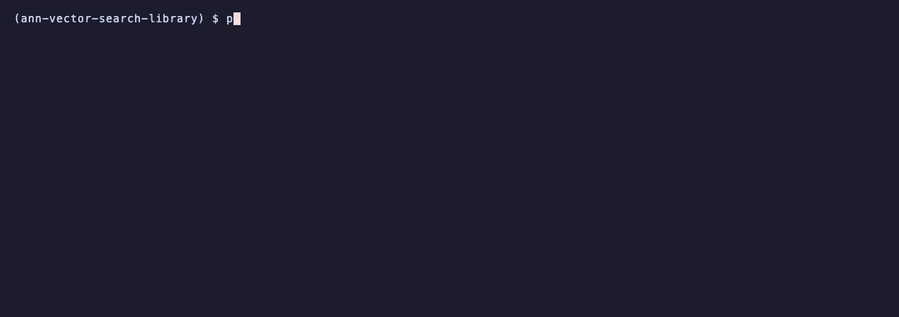
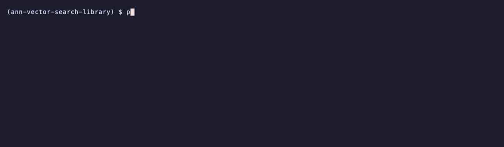

<h1 align="center">ANN Vector Search Library</h1>

<p align="center">
  <em>An approximate nearest neighbor vector search library built from scratch in Python with a Rust core, implementing HNSW (Hierarchical Navigable Small World) graphs, with recall and distance-computation cost measured against exact search.</em>
</p>

<p align="center">
  <a href="https://github.com/adeoluo/ann-vector-search-library/actions/workflows/ci.yml"></a>
  <a href="https://github.com/adeoluo/ann-vector-search-library/releases"></a>
  
  
  <a href="LICENSE"></a>
</p>

---

## Motivation

Nearest-neighbor search is the core of retrieval, recommendation, and
retrieval-augmented generation. A brute-force scan compares the query to every stored vector,
which is exact but costs one distance computation per point. **HNSW** builds a layered proximity
graph that reaches the true neighborhood while touching only a small fraction of the points. This
library implements HNSW from scratch following Malkov and Yashunin (2016), with the graph
construction, search, and distance computations all written out in the package.

The headline is the trade-off itself: the library reports recall against exact search **and** the
number of distance computations it performs, so the saving is measured, not asserted.

## Architecture

<p align="center">
  
</p>

<sub>Legend: amber = entry points and external systems, indigo = core logic, green = data and state, blue = validation and control, grey = observability and outputs.</sub>

Insertion assigns each point a random maximum level from a geometric distribution, greedily
descends through the sparse upper layers, then runs a bounded best-first search at each lower
layer and connects to neighbors chosen by a distance heuristic that spreads edges around the
point. Search mirrors insertion: a validated query descends greedily, widens to an `ef` beam at the
bottom layer, and returns the top k. A brute-force index over the same vectors supplies exact
ground truth, so recall, distance counts, and the cross-library comparison are all measured, and
the HTTP service records per-route Prometheus metrics. See the [ADRs](docs/adr/) for the key
decisions.

### What it implements

- **Layered graph construction** with geometric level assignment and bidirectional edges.
- **The neighbor-selection heuristic** that keeps connections diverse rather than clustered.
- **Bounded best-first search** (the ``ef`` beam) at the bottom layer, with greedy descent above.
- **Degree pruning** to a maximum of ``M`` edges per node (``2M`` at the base layer).
- **A brute-force index** and a **distance counter** so recall and cost are both measured.
- **A Rust core** (`rust/`, optional): the same HNSW, reproducing the Python index exactly
  (same graph, same neighbors, same distance counts), with parallel batch search.

## Results

> Reproduce with `python -m ann_vector_search_library benchmark`. Dataset: 2000 clustered
> 16-dimensional vectors; 100 held-out queries; recall@10 against exact search.

| Search width (ef) | Recall@10 | Distance ops/query | Fewer than brute force |
|---|---:|---:|---:|
| 16 | 0.755 | 146 | **13.7x** |
| 32 | 0.871 | 208 | 9.6x |
| 64 | 0.945 | 280 | 7.1x |
| 128 | 0.969 | 377 | 5.3x |

At ``ef`` 64 the index reaches **0.945 recall@10 while computing 280 distances per query versus
2000 for an exhaustive scan, a 7.1x reduction**. The search width ``ef`` trades recall against
cost along a smooth curve, and the saving grows with dataset size because graph search scales far
better than a linear scan.

### Wall-clock time against an exact scan

Distance-computation counts show the algorithmic saving, but latency is what a caller feels. This
comparison measures real query time against this library's own Python exact scan, averaged
over three seeds (`ef` 64, dim 16, 50 queries per seed):

| Vectors | Build time | Index query | Exact scan | Index speed-up | Recall@10 |
|---|---:|---:|---:|---:|---:|
| 1,000 | 0.42 s | 0.277 ms | 0.849 ms | 3.1x | 0.991 |
| 2,000 | 0.94 s | 0.343 ms | 1.712 ms | 5.0x | 0.943 |
| 4,000 | 2.21 s | 0.425 ms | 3.647 ms | 8.6x | 0.865 |

Against a same-language exact scan the index is faster, and the gap widens with dataset size
because its query cost grows far more slowly than a linear scan. The honest caveat is that this is
a same-interpreter comparison: an **optimized compiled library** (for example a vectorized exact
search in FAISS, hnswlib, or scikit-learn) can still outperform this Python approximate search on
small to medium workloads, because fewer distance computations do not offset per-operation
interpreter overhead.

### Measured against hnswlib and FAISS

The honest comparison the project needs is against the mature libraries themselves, so
`benchmarks/compare_libraries.py` runs the from-scratch index, **hnswlib** (the reference HNSW
implementation), and a **FAISS** flat index on the same data and scores each on recall against exact
ground truth, query latency, and build time. hnswlib, faiss, and numpy are opt-in `validation`
dependencies, used only for this comparison and not required by the core library.

> Reproduce with `uv sync --group validation && uv run python benchmarks/compare_libraries.py`.
> 10,000 clustered vectors, dim 16, 200 queries, `k` 10, matched HNSW parameters (`M` 16,
> `ef_construction` 200, `ef` 64).

| Library | Build time | Query latency | Recall@10 |
|---|---:|---:|---:|
| FAISS flat (exact, compiled) | 0.001 s | 0.083 ms | 1.000 |
| hnswlib (compiled) | 0.123 s | 0.028 ms | 0.926 |
| **from-scratch (Python)** | 18.66 s | 0.765 ms | **0.926** |

The key result is that the from-scratch index reaches **the same recall as hnswlib (0.926) at
matched parameters**, which is direct evidence that the HNSW graph construction and search are
implemented correctly, not merely internally consistent. The honest gap is wall-clock: the compiled
libraries build roughly 150x faster and answer queries roughly 27x faster, exactly what is expected
from an interpreted Python implementation versus optimized native code. The recall parity is enforced by an
opt-in test, `tests/test_library_parity.py`, which asserts the from-scratch recall tracks hnswlib
within a small tolerance. Closing the latency gap would require a vectorized or compiled backend,
which is noted in the roadmap.

### Scale

> Reproduce with `uv run python benchmarks/scale.py`. Synthetic clustered vectors, dim 16, `ef` 64,
> 50 queries per size; peak memory from `tracemalloc`.

| Vectors | Build time | Index query | Exact scan | Index throughput | Peak memory | Recall@10 |
|---|---:|---:|---:|---:|---:|---:|
| 1,000 | 2.9 s | 1.88 ms | 6.47 ms | ~533 q/s | 1.2 MiB | 0.982 |
| 2,000 | 6.2 s | 2.24 ms | 11.62 ms | ~447 q/s | 2.2 MiB | 0.928 |
| 4,000 | 14.1 s | 2.27 ms | 21.23 ms | ~441 q/s | 4.5 MiB | 0.908 |
| 8,000 | 31.1 s | 4.20 ms | 59.68 ms | ~238 q/s | 9.0 MiB | 0.786 |

As the dataset grows the index query time stays roughly flat while the exact scan grows linearly, so
the index's relative advantage widens (from about 3x to 14x fewer milliseconds per query), and memory
grows linearly with the vector count. These are synthetic data on this Python implementation: the
numbers show how the algorithm scales, not competitive absolute latency against a compiled library.

### Rust core

> Reproduce with `make rust-develop bench-compare`. 32 dimensions, M=8, ef_construction=64,
> k=10, ef=64, 200 queries; Apple M1, 8 cores. Query times include converting Python lists.

| Vectors | Build (Python) | Build (Rust) | Speedup | Query (Python) | Query (Rust) | Speedup | Batch query (Rust, parallel) | Same answers |
|---:|---:|---:|---:|---:|---:|---:|---:|:---:|
| 2,000 | 1.5 s | 0.07 s | 21x | 0.57 ms | 0.040 ms | 14x | 0.026 ms | yes |
| 10,000 | 12.5 s | 0.56 s | 22x | 0.89 ms | 0.058 ms | 15x | 0.028 ms | yes |

The speedup comes from compiled distance loops and data layout, not a different algorithm:
both indexes make exactly the same distance computations, which the parity tests assert.

### Evaluation

Datasets and queries are generated deterministically, so every number reproduces offline. Full
method and tables: [`docs/EVALUATION_REPORT.md`](docs/EVALUATION_REPORT.md).

### Comparison scope

The distance-computation reductions in the scaling tables are relative to an exhaustive
brute-force scan, measured as distance computations per query. The **"Measured against hnswlib and
FAISS"** section above goes further and benchmarks the index directly against
[FAISS](https://github.com/facebookresearch/faiss) and
[hnswlib](https://github.com/nmslib/hnswlib) on a shared dataset. The result is honest in both
directions: the from-scratch index matches hnswlib's recall at matched parameters (the algorithm is
correct), but the compiled libraries are far faster on wall-clock (roughly 27x on query latency), so
this project does **not** claim to beat them on performance. This Python implementation will not
match a compiled library's latency; closing that gap would require a vectorized or compiled backend.

## Quickstart

```bash
git clone https://github.com/adeoluo/ann-vector-search-library.git && cd ann-vector-search-library
make setup                      # install dev tooling + pre-commit hooks
make all                        # lint + type-check + test

python -m ann_vector_search_library benchmark   # recall and cost against exact search
python -m ann_vector_search_library search       # approximate vs exact neighbors for one query
python -m ann_vector_search_library serve        # start the HTTP service on :8000
```

```python
from ann_vector_search_library import HNSW

index = HNSW(dim=3, m=8, seed=0)
index.add(0, [0.1, 0.2, 0.3])
index.add(1, [0.9, 0.8, 0.7])
print(index.search([0.15, 0.2, 0.25], k=1))  # [(0, ...)]
```

## Usage

### Demonstration

```text
$ python -m ann_vector_search_library benchmark
Built HNSW over 1000 vectors (dim 16, M 8).
Recall and distance-computation cost against exact search:
  ef=16: recall=0.8600, 123 vs 1000 distance ops/query (8.1x fewer)
  ef=32: recall=0.9140, 163 vs 1000 distance ops/query (6.2x fewer)
  ef=64: recall=0.9740, 221 vs 1000 distance ops/query (4.5x fewer)
  ef=128: recall=1.0000, 324 vs 1000 distance ops/query (3.1x fewer)
```

### Rust backend

```bash
make rust-develop          # build the extension into .venv (needs a Rust toolchain)
```

```python
from ann_vector_search_library.backend import RustHNSW

index = RustHNSW(dim=32, m=8, ef_construction=64, seed=0)  # same constructor as HNSW
for i, vector in enumerate(vectors):
    index.add(i, vector)
index.search(query, 10, ef=64)
index.search_batch(queries, 10, ef=64)  # parallel, GIL released
```

### HTTP service

A standard-library HTTP service builds the index at startup, then answers queries. The routing
logic is a pure function, tested without a socket. Under a concurrent stress benchmark
(`uv run python benchmarks/stress.py`, 3000 requests, 8 workers) the `/search` handler sustains
roughly **600 queries/second** at **p50 1.4 ms** on one CPU.

| Method | Path | Purpose |
|---|---|---|
| GET | `/health` | liveness and index size |
| GET | `/ready` | readiness once the index is built |
| GET | `/metrics` | per-route request, error, and latency metrics (Prometheus text) |
| POST | `/search` | body `{"vector": [float], "k": int?, "ef": int?}`; nearest neighbors |
| GET | `/recall` | recall@k of the index against exact search on held-out queries |

### Demos

Recorded from real runs with [vhs](https://github.com/charmbracelet/vhs); each tape is in `docs/demo/`.

Recall and distance computations against an exact scan.

<p align="center">
  
</p>

A nearest-neighbor search with its distance count.

<p align="center">
  
</p>

## Design decisions

- **HNSW over IVF or a k-d tree** - HNSW gives strong recall in high dimensions where tree
  methods degrade, and it supports incremental insertion. See [ADR 0002](docs/adr/0002-hnsw.md).
- **A measured distance counter** - reporting comparisons per query makes the recall/cost
  trade-off concrete rather than a claim. See [ADR 0003](docs/adr/0003-measured-cost.md).
- **A Rust core that reproduces the Python index exactly** - levels are drawn on the Python
  side from the same seeded generator and passed in, and the Rust code makes the same
  distance calls in the same order, so the two can be compared call for call. See
  [ADR 0004](docs/adr/0004-rust-core-exact-reproduction.md).

## Testing

```bash
make test                     # or: uv run pytest
uv run pytest --cov=src --cov-report=term-missing --cov-fail-under=80

# opt-in recall parity against hnswlib and FAISS
uv sync --group validation && uv run pytest tests/test_library_parity.py

# Rust core: unit tests, then parity with the Python index
make rust-check rust-develop parity
```

`tests/test_rust_parity.py` builds both indexes from the same data and asserts identical
search results and identical distance counts, for both metrics, three `M`/`ef` settings,
three `ef` values at query time, arbitrary integer ids, and parallel batch search.

The suite in `tests/` uses seeded synthetic data, so results are deterministic:

- `test_hnsw.py`: distance metrics, input validation (dimension, duplicate ids, unknown
  metric), empty and single-element indexes, result ordering, determinism, recall rising
  with `ef`, fewer distance computations than brute force, exactness of the brute-force
  index, the shape of the recall curve, and the timed comparison report.
- `test_service_cli.py`: the HTTP handler layer (`/health`, `/ready`, `/search`, `/recall`,
  `/metrics`, validation, unknown routes) and the CLI commands.
- `test_library_parity.py`: an opt-in differential test asserting that the from-scratch
  recall tracks hnswlib within a small tolerance. It is skipped unless the `validation`
  dependency group is installed.

CI (`.github/workflows/ci.yml`) runs `ruff format --check`, `ruff check`, `mypy src`, and
`pytest` with an 80% coverage gate on Python 3.11 and 3.12, then builds the package and the
Docker image. A separate job runs `cargo fmt`, `clippy`, and `cargo test`, builds the
extension, and runs the parity tests with the extension required.

## Responsible AI

- **Model card:** [`docs/MODEL_CARD.md`](docs/MODEL_CARD.md)
- **Data card:** [`docs/DATA_CARD.md`](docs/DATA_CARD.md)
- **Threat model:** [`docs/THREAT_MODEL.md`](docs/THREAT_MODEL.md)

## Limitations

- The Python index is slow per comparison; the optional Rust core is 14 to 22 times faster but
  still uses scalar `f64` loops without SIMD or quantization, so it remains slower than hnswlib.
- Results match exactly only when no two distances are equal; with exact ties the two
  implementations may order tied neighbors differently.
- The index is in-memory and not persisted; there is no on-disk format or deletion support.
- Recall depends on ``M`` and ``ef``; the defaults suit the bundled datasets and may need tuning
  for other distributions.

## Roadmap

- [x] Benchmark recall and wall-clock latency against hnswlib and FAISS on a shared dataset.
- [x] Add a compiled backend (Rust core, exact reproduction of the Python index).
- [ ] SIMD distance kernels and `f32` storage in the Rust core.
- [ ] Add node deletion with lazy tombstones and re-linking.
- [ ] Add a persisted on-disk index format.
- [ ] Add scalar quantization of stored vectors to cut memory.

## License

Released under the [MIT License](LICENSE).
